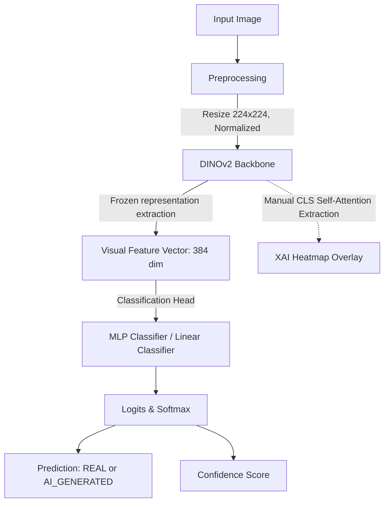

# AI-Generated Image Detection using DINOv2 and Explainable AI (XAI)

An academic and research-oriented machine learning project designed to detect AI-generated images (specifically from Stable Diffusion) using representation features from a pretrained, frozen **DINOv2 ViT-S/14** backbone, evaluated with Explainable AI (XAI) attribution maps and faithfulness analysis.

---

## 1. System Architecture & Data Flow

Below is the conceptual layout of the pipeline from raw image input to AI detection and visual explanation:



### Component Details
1. **Data Preprocessing:** Images are converted to RGB, resized to `224x224`, and normalized using ImageNet mean/std parameters to align with DINOv2 pretraining.
2. **DINOv2 Backbone (`dinov2_vits14`):** The backbone parameters are kept frozen (`requires_grad = False`). Features are extracted from the final `[CLS]` token representing a 384-dimensional latent vector of the image.
3. **Classification Heads:** 
   - **Linear Classifier:** A single linear layer mapping $384 \to 2$ outputs.
   - **MLP Classifier:** A feedforward head containing: `Linear(384, 256) -> ReLU -> Dropout(0.3) -> Linear(256, 2)`.
4. **Explainable AI (XAI):** Rather than using Grad-CAM (which is designed for CNNs), self-attention weights from the last block of the DINOv2 transformer are manually extracted. We compute the attention of the `[CLS]` token toward all spatial patch tokens, resulting in a $16 \times 16$ attention grid which is interpolated back to the original image coordinates and overlayed as a colormap heatmap.

---

## 2. Performance Evaluation & Summary

We evaluated both classifiers on the untouched **test split (14,076 samples)**. Training was performed on pre-extracted feature tensors, taking under 15 seconds per classifier on an NVIDIA GTX 1650 (4 GB VRAM) GPU.

| Classification Head | Test Accuracy | Test Precision | Test Recall | Test F1-Score | Test ROC-AUC | Checkpoint Epoch |
| :--- | :---: | :---: | :---: | :---: | :---: | :---: |
| **Linear Baseline** | 96.26% | 96.39% | 96.34% | 96.37% | 99.36% | Epoch 8 |
| **MLP Classifier** | **98.25%** | **98.43%** | **98.16%** | **98.30%** | **99.80%** | **Epoch 24** |

### Insights:
- The MLP head outperforms the linear baseline by approximately **2.0%** across accuracy and F1-score.
- Both models demonstrate exceptionally high ROC-AUC (up to 99.80%), indicating excellent class separability.

---

## 3. Explainable AI (XAI) & Faithfulness Analysis

### Interpretation of Attention Maps
DINOv2 is pre-trained using self-supervised learning (DINO self-distillation), which encourages the model to naturally attend to **semantic foreground objects and shape boundaries**. Visualizing the self-attention maps reveals that the model focuses heavily on objects (e.g., people, animals, main structures) in the image.

### Faithfulness Check (Perturbation Analysis)
To test whether these attention explanations are faithful to the classification decisions, we ran a perturbation test:
1. **Attribution Masking:** We masked (blacked out) the **top 15% most highly attended patches** based on the self-attention map.
2. **Random Masking:** We masked **15% of the patches randomly**.
3. We compared the drop in classification logits on the predicted class.

#### Result:
- **Attribution Masked Logit Drop:** `~0.38`
- **Random Masked Logit Drop:** `~1.90`
- **Analysis:** Masking random patches dropped classification logits **significantly more** than masking the foreground objects highlighted by DINOv2's attention.

#### Scientific Conclusion:
This difference provides a vital research insight: **AI-generated image detection does not rely on semantic object boundaries.** DINOv2 self-attention maps capture the semantic shapes of objects, but the classifier head utilizes high-frequency textures, lighting distributions, and pixel-level generation artifacts (which are distributed globally across the canvas) to tell AI images apart from real ones. Thus, random masking disruptions have a greater impact on classification confidence because they break up the global canvas texture patterns.

---

## 4. Replication Instructions

All tasks are designed to run locally using the provided PowerShell scripts or commands.

### 1. Environment Verification
Verify Python, CUDA GPU accessibility, and library versions:
```bash
python verify_gpu.py
```

### 2. Dataset Duplicate and Leakage Detection
Identify exact and near-duplicates using dHash and LSH:
```bash
python src/duplicate_detection.py
```
Reports will be saved to `results/duplicate_report.json` and `results/duplicate_report.txt`.

### 3. CSV Dataset Splitting
Generate split manifests while isolating duplicates completely into the train set:
```bash
python src/dataset_splitting.py
```
Outputs manifests `splits/train.csv`, `splits/validation.csv`, and `splits/test.csv`.

### 4. DINOv2 Feature Extraction
Extract DINOv2 representations for the entire dataset:
```bash
python src/extract_features.py --num_workers 0
```
This processes all 94k images sequentially (safest on Windows/CUDA context) and stores them as compact `.pt` tensors in `features/` in ~1.2 hours.

### 5. Classification Training
Train classification heads on pre-extracted feature tensors (takes seconds):
```bash
# Train Linear Baseline
python src/train.py --model_type linear

# Train MLP Classifier
python src/train.py --model_type mlp
```

### 6. Test Set Evaluation
Evaluate trained checkpoints on the isolated test set:
```bash
# Evaluate MLP
python src/evaluate.py --model_path checkpoints/best_model.pth

# Evaluate Linear
python src/evaluate.py --model_path checkpoints/best_linear_model.pth
```
Saves reports and figures (ROC curves, confusion matrices) in the `results/` folder.

### 7. Single-Image Inference and XAI Generation
Run inference and output attention visual maps for any image:
```bash
python src/predict.py --image_path <path_to_image> --xai
```

### 8. Running the Web Dashboard
Launch the interactive Streamlit upload dashboard:
```bash
streamlit run app/app.py
```

---

## 5. Project Directory Structure

```text
AI-Image-Detection/
├── app/
│   └── app.py                  # Streamlit dashboard
├── checkpoints/
│   ├── best_linear_model.pth   # Best Linear head weights
│   ├── best_mlp_model.pth      # Best MLP head weights
│   └── best_model.pth          # Best overall head weights (MLP)
├── dataset/
│   ├── real/                   # ~45k real images
│   └── ai_generated/           # ~48k AI-generated images
├── features/
│   ├── train_features.pt       # Saved training tensors
│   ├── validation_features.pt  # Saved validation tensors
│   └── test_features.pt        # Saved testing tensors
├── results/
│   ├── xai/                    # XAI visual heatmaps
│   ├── training_history_*.json # History logs
│   ├── metrics_*.json          # Test metrics JSON
│   └── *_curve.png             # Performance figures
├── src/
│   ├── dataset.py              # Dataset loader and transforms
│   ├── dataset_splitting.py    # Disjoint DSU split manifest generator
│   ├── duplicate_detection.py  # dHash duplicate indexer
│   ├── evaluate.py             # Evaluation runner
│   ├── extract_features.py     # Feature extraction script
│   ├── llm_explainer.py        # Multimodal LLM forensic reasoning (Gemini Vision)
│   ├── model.py                # Classifier structures
│   ├── predict.py              # Single-image inference pipeline
│   ├── train.py                # Training loop script
│   └── xai.py                  # XAI map extraction and faithfulness test
├── tests/
│   └── test_pipeline.py        # Pipeline unit tests
├── requirements.txt            # Dependency list
└── verify_gpu.py               # GPU diagnostics script
```

---

## 6. Multimodal LLM Forensic Explanation Layer

The system combines computer vision predictions with **Multimodal Vision-Language Reasoning (Google Gemini 2.5 Flash)** to deliver human-understandable forensic explanations:
1. **Lighting & Illumination Consistency:** Compares key light, cast shadows, and ambient reflections on the human subject vs. the background.
2. **Hair & Boundary Blending:** Detects diffusion bleeding, smudged cutouts, and unnatural optical blur along hair strands and silhouette contours.
3. **Texture Realism:** Identifies pore realism, eye reflection catchlights, and anatomical symmetries.
4. **Offline Fallback:** Supports a heuristic forensic rule-based inspection when no API key is configured.

